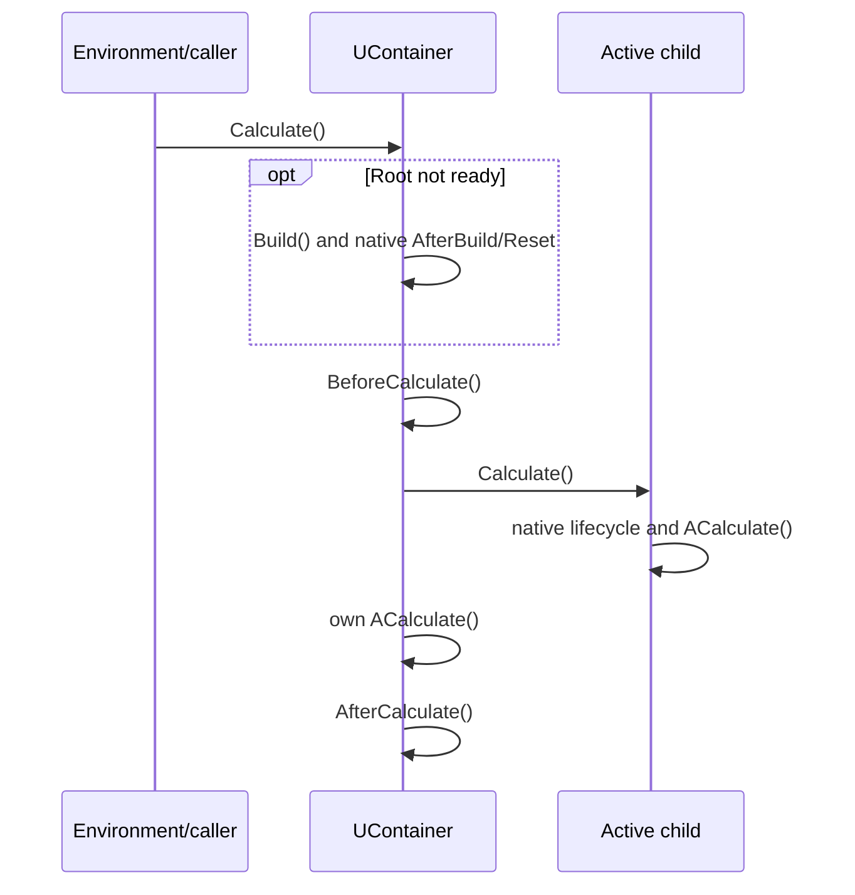

# Жизненный цикл компонента / Component lifecycle

## RU

[Канонический контракт UModule/UContainer](../Engine/NativeLifecycle.md)
содержит точный порядок, ветви пропуска, lifecycle bool и правила загрузки.
Ready и InitFlag — независимые признаки, а не последовательные стадии.
Default, Build, Init и Reset не являются независимыми линейными шагами:
AfterDefault вызывает Build, AfterBuild — Reset, а Init — Reset → Build.

Следующая схема относится к уже инициализированному активному дереву одной
частоты без request повторного расчёта и ограничений времени. Public methods
детей сами вызывают их hooks; родитель не вызывает детские ACalculate напрямую.

При Activity=false или InitFlag=false Calculate возвращает true до расчёта
детей. Init сначала инициализирует детей, затем AInit/InitFlag/Reset владельца.
Reset может войти в Build/BeforeReset и пропустить AReset при InitFlag=false.
Storage TakeObject/Copy/Load не означают дополнительный Default созданного образа.
Отказы не являются переходом «false → удалить компонент»; применяются диагностика
и контракт конкретной операции.

## EN

See the [canonical native contract](../Engine/NativeLifecycle.md). Ready and
InitFlag are independent. AfterDefault calls Build; AfterBuild calls Reset;
UContainer.Init calls Reset, which itself calls Build. These are not independent
linear setup stages. The diagram assumes an initialized active single-rate tree
without recalculation/skip/time limits. Parents invoke child.Calculate rather
than child.ACalculate. Inactive/uninitialized Calculate skips child execution and
returns true. TakeObject/Copy/Load do not authorize an extra Default of an image.
Failure diagnostics do not imply an automatic false-return/delete transition.
