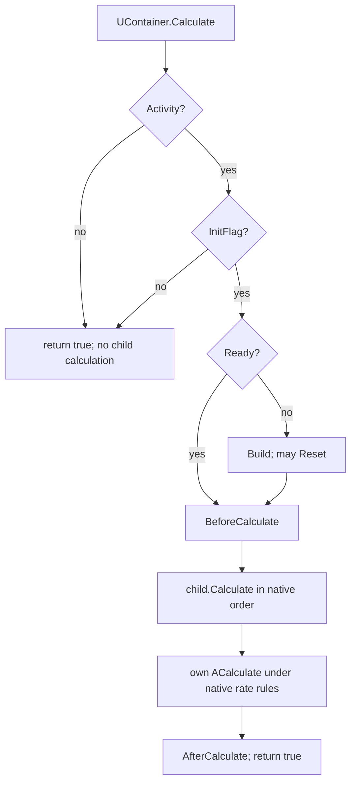

# Native component lifecycle / Штатный жизненный цикл

## RU

Описание проверено по Core дерева `a62393f7791cc4ad10d1c2c11f255b3db3334f89`.
Это контракт существующего выполнения, не изменение scheduler. Источники:
[UModule.cpp](../../Core/Engine/UModule.cpp),
[UContainer.cpp](../../Core/Engine/UContainer.cpp),
[UNet.cpp](../../Core/Engine/UNet.cpp).

### Два независимых признака

`Ready` и `InitFlag` различаются. `IsReady()` читает Ready, `IsInit()` — InitFlag.
Готовый родитель не доказывает готовности всех потомков после отдельной правки
дочернего компонента. Инициализированный компонент может требовать новой сборки.
Build не является рекурсивной командой «исправить всё дерево»: ready-контейнер
возвращает управление до обхода детей. Изменение leaf property не обязано
автоматически инвалидировать владельцев.

У свойств UVProperty/UVVectorProperty CheckEqualsFlag по умолчанию включён:
SetData равного локального значения возвращается до setter. При connected input
SetData не заменяет связанное значение, а при ExternalDataSource перенаправляет
запись источнику. Это видно в [UProperty.h](../../Core/Engine/UProperty.h).
Самоприсваивание не является командой rebuild; изменение вектора через прямой
доступ к данным также не доказывает выполнение setter/инвалидации. Применять
параметры надо через контракт владельца, с проверкой effective readback.

Публичные `Build/Reset/Calculate` возвращают true как артефакт интерфейса.
Это не подтверждение сборки, вычисленного отклика или сброса. Отказы проверяют
по специализированной диагностике, operation ledger и фактическому состоянию
графа. [Lifecycle observations](LifecycleObservation.md) также не доказывают
успешность операции: observation фиксирует вход в lifecycle, а не её результат.

### Фактический порядок UContainer

| Операция | Условия и порядок |
|---|---|
| Default | BeforeDefault → Ready=false → Default всех детей → собственные defaults/ADefault → AfterDefault. Унаследованный AfterDefault вызывает Build. Default может менять физику и частоту; не применять после TakeObject к проверяемому образу |
| Build | При Ready=true возвращается до обхода детей; отсутствие Storage также означает пропуск. Иначе BeforeBuild → Build статических детей → Build активных детей → ABuild → Ready=true → AfterBuild → UpdateComputationOrder и invalidation active cache |
| AfterBuild | Унаследованный UModule: AAfterBuild → Reset. Вложенный Reset видит уже установленный Ready |
| Init | При Activity=false либо InitFlag=true пропуск. Иначе observation advance → Init всех детей → AInit → InitFlag=true → Reset. Generic BeforeInit/AfterInit hooks UModule здесь не вызываются |
| Reset | Build → SharesInit → BeforeReset; затем при InitFlag=false возврат true без AReset. Иначе Reset статических/активных детей → AReset → сброс счётчиков → AfterReset |
| Calculate | При Activity=false либо InitFlag=false возврат true без Build и без расчёта детей. Иначе Build, если !Ready → BeforeCalculate → Calculate активных детей в штатном порядке → собственный ACalculate по правилам частот → AfterCalculate |
| UnInit | При InitFlag=false пропуск; иначе observation advance → AUnInit → UnInit детей → InitFlag=false. Generic BeforeUnInit/AfterUnInit hooks UModule здесь не вызываются |

В частности, Init косвенно запускает Build через Reset. И наоборот, Build
косвенно запускает Reset через AfterBuild. Reset не устанавливает InitFlag
самостоятельно: возможен Build и BeforeReset без выполненного AReset.

Приведённый порядок Calculate не обещает один вызов ACalculate для произвольной
multirate-конфигурации. Частоты владельца/ребёнка, ComponentReCalculation,
SkipComponentCalculation и time checks могут менять фактическое выполнение.
Контроллер, рассчитанный на один шаг дерева, должен проверять эту capability,
а не подменять scheduler вложенным Calculate или скрытым изменением частот.

UModule сам по себе не обходит дерево. Его Init вызывает BeforeInit/AInit/
AfterInit; его Reset при !Ready вызывает Build и возвращается. Эти реализации
нельзя механически приписывать UContainer, переопределяющему данные методы.

### Загрузка образа и владение структурой

TakeObject, Copy, Load и вызов конструктора не являются одной операцией.
UNet.LoadComponent читает параметры, удаляет прежних детей, создаёт и загружает
новых детей и восстанавливает объявленные связи. Он не сохраняет произвольное
process-local состояние контроллера. Обновлять сохранённые pointers/arrays нужно
по штатному контракту конкретного класса; успешный bool Load не заменяет readback.

LoadComponent с links=true может косвенно вызвать Build уже внутри загрузки:
UNet.SetComponentInternalLinks вызывает BreakLinks и CreateLinks; рекурсивный
BreakLinks вызывает UItem.DisconnectAll, а этот метод входит в Build.
UItem.Connect и UConnector.ConnectToItem также вызывают Build своих объектов.
Следовательно, отложить явный вызов model.Build до завершения Load недостаточно,
чтобы отложить структурную сборку. Это штатное поведение операций связей,
подтверждённое [UItem.cpp](../../Core/Engine/UItem.cpp) и
[UConnector.cpp](../../Core/Engine/UConnector.cpp), а не причина обходить их
прямой записью pointers. Полный граф следует загружать в разрешённом владельцем
режиме сохранения структуры и затем применять его штатный import/adoption.
Переход в режим автоматического построения должен быть осмысленным изменением
конфигурации, а не самоприсваиванием для принудительного пробуждения.

Класс-владелец может намеренно пересоздать структуру из своего storage-профиля
при Build. Тогда загрузка готового неоднородного графа с последующим Build такого
владельца не гарантирует его сохранности. Следует выбрать поддерживаемый режим
явного графа либо штатный import/adoption API этого класса. Если API требует
готовых физических детей, их подготавливают до принятия владельцем; нельзя
сначала запускать несовместимое структурное восстановление, а потом объявлять
полученный граф эквивалентным загруженному.

Не исправлять это self-assignment параметров, ручными Ready toggles, повторным
Default, изменением общего storage prototype или ремонтными записями на тике.
Проверять фактические классы детей, индивидуальные параметры, связи, порядок,
Ready/Init и физический отклик. Полный export модели, parameter overlay и
checkpoint динамики — разные операции; Alloc/Copy не доказывают checkpoint.

## EN

This documents the existing Core lifecycle at a62393f7; it changes no scheduler
or component code. Ready and InitFlag are independent. A ready UContainer.Build
returns before visiting children; a leaf setter need not invalidate ancestors.
Build/Reset/Calculate return true as interface artifacts, so use typed diagnostic
state, the operation ledger and effective graph/response readback.

UContainer.Init skips inactive/already initialized nodes; otherwise it initializes
children, calls AInit, sets InitFlag and calls Reset. Reset calls Build, SharesInit
and BeforeReset before its initialization guard. A successful Build sets Ready
before inherited AfterBuild calls Reset. Consequently Init can indirectly Build,
and Build can indirectly Reset. Reset alone does not initialize an uninitialized
component. UContainer Init/UnInit bypass generic UModule before/after hooks; their
lifecycle observations advance at actual entry. UModule has different non-tree
implementations and must not be confused with UContainer.

UContainer.Calculate skips inactive or uninitialized nodes, including children.
Otherwise it builds if necessary, invokes BeforeCalculate, calls child.Calculate
in native order, runs its own ACalculate under native rate rules, and invokes
AfterCalculate. It does not directly call each child's ACalculate. Multirate,
recalculation, skip and timing controls require their own capability validation.

UNet.LoadComponent reconstructs declared children and links; it is not a
process-local controller checkpoint. A structural owner may intentionally rebuild
the loaded graph from its profile. Use its explicit graph/import/adoption contract,
prepare required physical children before adoption, refresh handles, and verify
effective classes/parameters/bindings/order and response. Do not repair this with
extra Default, self-assignment, Ready toggles, prototype mutation or per-tick writes.

Link restoration is itself a lifecycle boundary: LoadComponent(links=true) calls
SetComponentInternalLinks → BreakLinks/CreateLinks. UItem.DisconnectAll,
UItem.Connect and UConnector.ConnectToItem call Build. Deferring an explicit
model.Build until after Load therefore does not defer all structural builds.
Use the owner's supported graph-preservation/import/adoption mode while restoring
links. Do not bypass native links with raw pointer writes or force wake-ups.

UVProperty/UVVectorProperty enable equality checks by default: setting the same
local value skips the setter. Connected input writes are ignored; ExternalDataSource
writes are forwarded. Self-assignment is not a rebuild operation, and direct
vector-data mutation does not prove setter execution or invalidation. Use the
owning component's contract and effective readback.
